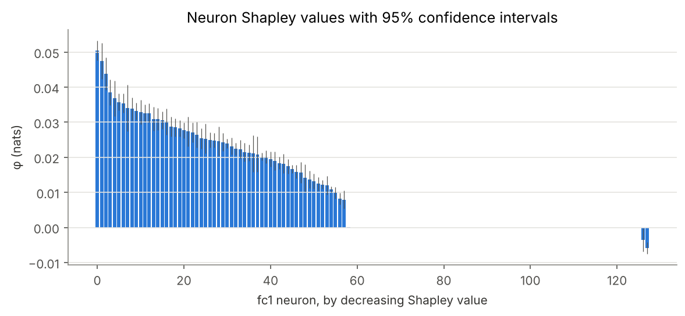
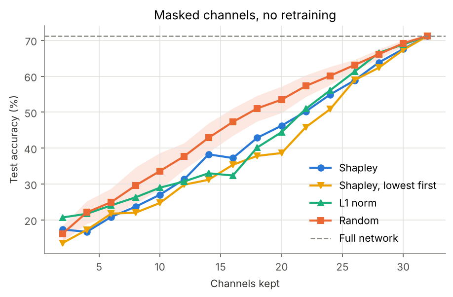
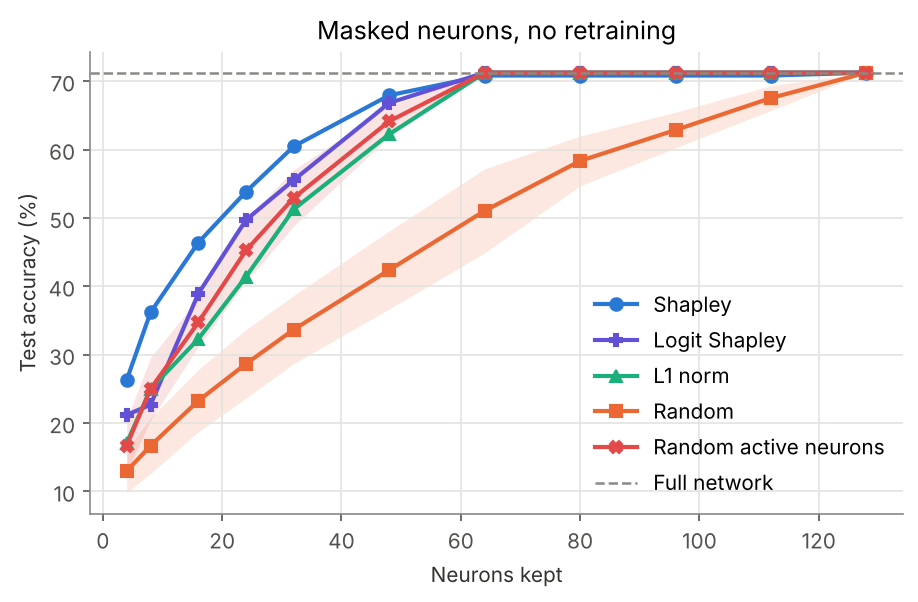
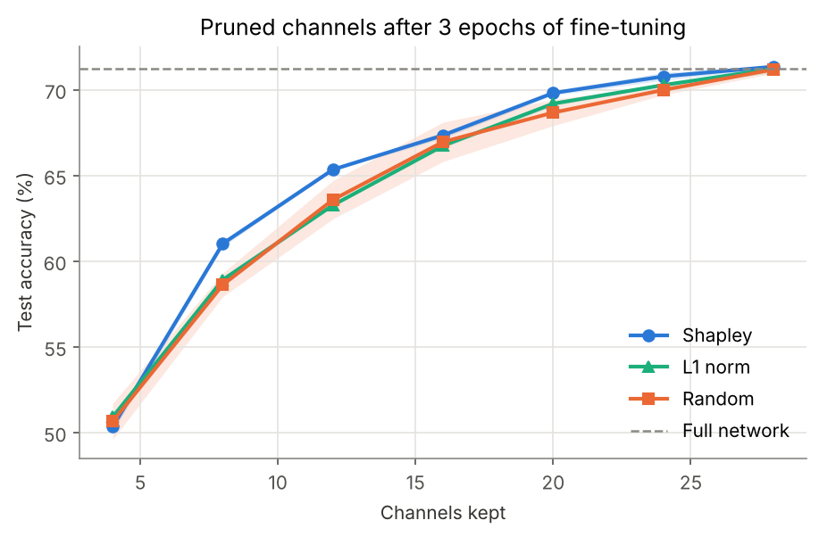
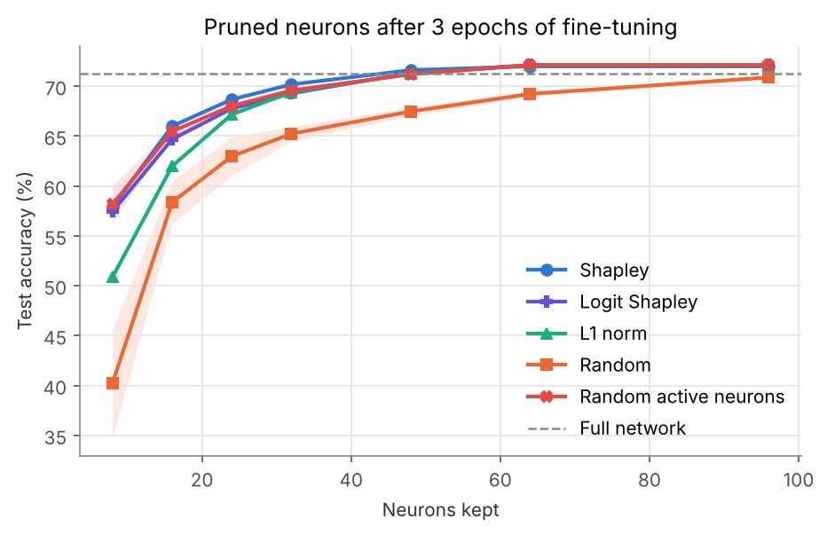
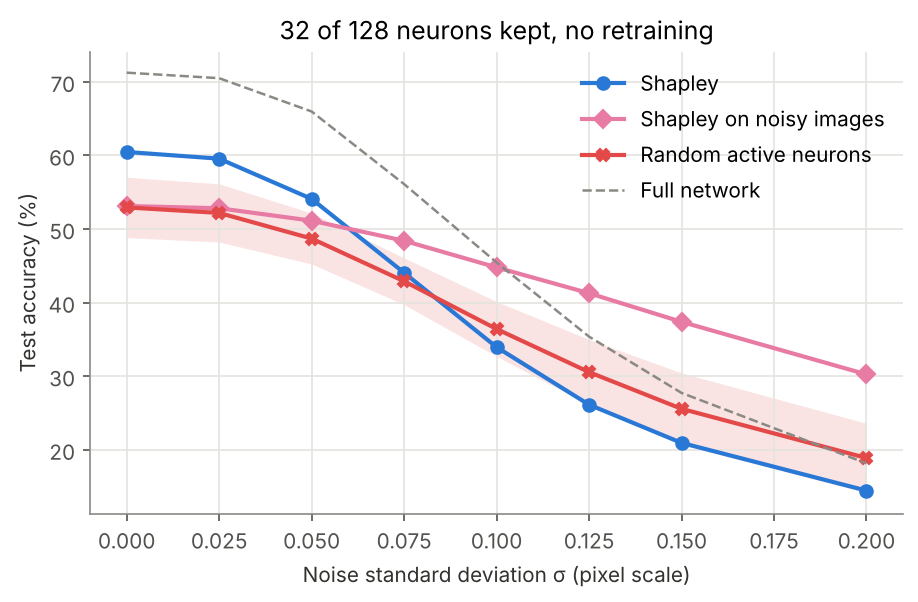
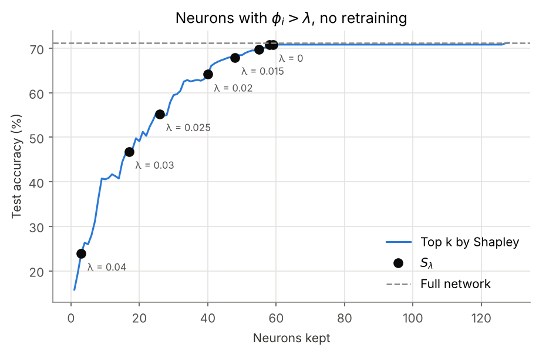

# Shapley Pruning: Which features of a neural network really matter?

Convolutional neural networks contain a large number of internal features, such as channels and neurons, and not all of them contribute equally to the model's predictions. Some may be essential for accurate recognition, while others may be redundant or unused. Identifying the features that truly matter makes it possible to build smaller, faster and more interpretable models. In this project, we address this problem with the Shapley value from cooperative game theory [1]: each feature of a layer is treated as a player, and its Shapley value measures its average contribution to the network's performance. We estimate these values for the channels and neurons of a CNN trained on CIFAR-10 [4], use them to prune the network, and compare the result with random and magnitude-based pruning [5].

For the network we trained, our experiments lead to three main findings:

- **Half of its dense-layer neurons are never used.** 67 of the 128 neurons of `fc1` never activate on any training image, and each of them receives a Shapley value of exactly 0, as the theory predicts for a player that never contributes.
- **Its best channels do not make the best team.** Together, the four channels with the highest Shapley values perform worse than no channel at all. A Shapley value measures a feature's average contribution, so the features that are best on average are not guaranteed to work well together.
- **Shapley values selected a sub-network that is more robust to noise than the full network.** When computed on noisy images, they selected 32 neurons that keep 30.2% accuracy under strong noise, whereas the full network drops to 18.1%, without any retraining.

## Table of Contents

- [How It Works](#how-it-works)
- [Results](#results)
- [Notebooks](#notebooks)
- [Getting Started](#getting-started)
- [Ideas for Extensions](#ideas-for-extensions)
- [References](#references)
- [License](#license)

## How It Works

The method works in four steps:

1. Train a small CNN on CIFAR-10.
2. Treat the units of one layer, the 32 channels of `conv2` or the 128 neurons of `fc1`, as players. The payoff of a group of units is the network's performance when only those units are active.
3. Estimate the Shapley value of each unit, its average contribution over random orders in which the units join the group [2].
4. Prune the network to the units with the highest values, and compare it with other ways of choosing the units, with and without fine-tuning.

**The network.** `conv1 (3→32) → pool → conv2 (32→32) → pool → fc1 (2048→128) → fc2 (128→10)`, with a ReLU after every hidden layer, trained for 10 epochs with Adam on 45 000 training images. It has 273 706 parameters and reaches 71.24% accuracy on the 10 000 test images.

**The game.** A group $S$ of units is switched on by multiplying the layer's output by a binary mask, and its payoff is the negative cross-entropy loss on 5 000 validation images held out from the training set:

```math
v(S) = -\frac{1}{|D_\text{val}|} \sum_{(x, y) \in D_\text{val}} \mathcal{L}\big(f(x; m_S), y\big)
```

The empty group is measured like any other. With every unit switched off, the network makes the same prediction for every image, and $v(\varnothing) \approx -2.3$, about the loss of a uniform guess.

**The Shapley value.** Unit $i$ gets its marginal contribution averaged over all the orders in which the units can join, where $P_i^\sigma$ is the set of units that come before $i$ in the order $\sigma$:

```math
\phi_i = \frac{1}{n!} \sum_{\sigma} \Big[v\big(P_i^\sigma \cup \{i\}\big) - v\big(P_i^\sigma\big)\Big]
```

The exact value needs all $2^n$ groups, so we sample 500 random orders. Adding the units one by one along an order gives one contribution per unit for $n + 1$ evaluations of the network, and the contributions along an order always add up to $v(N) - v(\varnothing)$, so the estimates keep the efficiency property exactly. The layers before the player layer do not depend on the group, so they run once, and each evaluation only runs the layers after it.

**Properties we use.** For the payoff "logit of the true class", the logit is a linear function of the `fc1` neurons, so the Shapley value has a closed form, $`\phi_i = \frac{1}{|D_\text{val}|} \sum_{(x, y) \in D_\text{val}} W_{y,i}\, a_i(x)`$, where $`a_i(x)`$ is the activation of neuron $i$ and $W$ the weights of `fc2`. Charging $\lambda$ per unit kept lowers every value by exactly $\lambda$. And since the global loss is a weighted sum of the per-class losses, the global values are the same weighted sum of the per-class values. The notebooks and the tests check each of these numerically.

**Selection rules.** Each rule keeps $k$ units of a layer:

- **Shapley**: the $k$ highest Shapley values.
- **L1 norm**: the $k$ units with the largest weights, measured by the L1 norm of their incoming weights [5].
- **Random**: $k$ units drawn at random.
- **Random active neurons**: $k$ neurons drawn at random among those that activate on at least one training image. This is the fair random baseline for the neurons, because many of them never activate.

**Evaluation.** Every selection is tested in two ways, always on the 10 000 test images, which are never used to choose units:

- **Without retraining**, the trained network is run with only the selected units active and its weights unchanged.
- **With fine-tuning**, the selected units become a smaller network: removing a channel deletes its `conv2` filter and the `fc1` weights that read it, and removing a neuron deletes its `fc1` row and the `fc2` column that reads it. The smaller network gives exactly the same output as the masked one, and is then retrained for 3 epochs, once with each of the seeds 0, 1 and 2.

## Results

These results describe the network we trained. They are not general claims about other architectures or datasets.

### The Shapley values

Figure 1 shows the estimated Shapley values of the 128 neurons of `fc1`, sorted from the highest to the lowest.

<p align="center">
  
</p>
<p align="center"><em>Figure 1. Shapley values of the 128 <code>fc1</code> neurons with 95% confidence intervals, from <a href="2_neuron_shapley.ipynb"><code>2_neuron_shapley.ipynb</code></a>.</em></p>

59 neurons have a value clearly above 0 and 2 have a value clearly below. The other 67 never activate on any training image, and their value is exactly 0, as the theory predicts for a player that never contributes. The 32 channels of `conv2` behave differently: 29 have a positive value, and none is inactive.

### Pruning without retraining

The first test keeps the $k$ units chosen by each rule, switches off all the others, and measures the accuracy of the trained network without changing any weight. It shows how well each ranking identifies the units the network relies on.

<p align="center">
  
  
</p>
<p align="center"><em>Figure 2. Test accuracy against the number of units kept, without retraining, for the channels (left, <a href="1_channel_shapley.ipynb"><code>1_channel_shapley.ipynb</code></a>) and the neurons (right, <a href="2_neuron_shapley.ipynb"><code>2_neuron_shapley.ipynb</code></a>). Shaded bands show one standard deviation over 20 random draws, and the dashed line is the full network.</em></p>

- **For the neurons, the Shapley ranking is the best by far.** The 32 neurons with the highest values give 60.5% accuracy, against 52.9% for 32 random active neurons. These neurons feed the output layer directly, so their contributions roughly add up, and the neurons that are best on average also work well together.
- **For the channels, the best players do not make the best team.** The channels interact through the next layer, so a group made only of the best channels does badly, and random channels beat the top-ranked ones at every size from 4 to 30. The four channels with the highest values together are even worse than no channel at all. A Shapley value is an average over random groups, not the value of one particular group.
- **The dead neurons distort the plain random comparison.** Plain random pruning keeps many of the 67 dead neurons, which is why it falls far behind the other rules.

### Pruning with fine-tuning

The second test retrains each smaller network for 3 epochs. It shows whether a better ranking still gives a better network once the network can adapt.

<p align="center">
  
  
</p>
<p align="center"><em>Figure 3. Test accuracy of the pruned networks after fine-tuning, for the channels (left) and the neurons (right). Each point is the mean over 3 seeds, shaded bands show one standard deviation, and the dashed line is the full network before pruning.</em></p>

After retraining, the rules end up close, as the pruned network adapts to whatever it keeps. Shapley pruning is the best rule at most sizes: by up to 2.4 points for the channels, and by 0.4 to 0.7 points over random active neurons for the neurons. The table compares the two tests at a few sizes.

| Units kept | | Shapley | L1 norm | Random |
| --- | --- | --- | --- | --- |
| 8 of 32 channels | without retraining | 23.68 | 26.29 | **29.58 ± 5.07** |
| | with fine-tuning | **61.03 ± 0.18** | 58.92 ± 0.19 | 58.62 ± 0.69 |
| 16 of 32 channels | without retraining | 37.24 | 32.38 | **47.28 ± 3.81** |
| | with fine-tuning | **67.35 ± 0.18** | 66.74 ± 0.13 | 66.96 ± 1.15 |
| 16 of 128 neurons | without retraining | **46.39** | 32.29 | 34.72 ± 3.55 |
| | with fine-tuning | **65.98 ± 0.15** | 61.97 ± 0.23 | 65.45 ± 0.39 |
| 32 of 128 neurons | without retraining | **60.46** | 51.27 | 52.92 ± 4.10 |
| | with fine-tuning | **70.17 ± 0.11** | 69.39 ± 0.18 | 69.56 ± 0.37 |

Test accuracy in %. For the neurons, the random column uses random active neurons.

### Robustness to noise and a cost per neuron

The left plot of Figure 4 adds Gaussian noise to the test images and compares three ways of choosing 32 neurons, without retraining: the top 32 Shapley values computed on clean images, the top 32 computed on noisy images, and random active neurons. The right plot charges a cost $\lambda$ for every neuron kept and keeps the neurons whose Shapley value is above $\lambda$.

<p align="center">
  
  
</p>
<p align="center"><em>Figure 4. Left: test accuracy of 32 neurons as the noise grows, with the full network as a dashed line. Right: the sets kept for several values of λ (black dots) on the accuracy curve of the top-k neurons (blue). Both from <a href="2_neuron_shapley.ipynb"><code>2_neuron_shapley.ipynb</code></a>.</em></p>

- **Shapley values computed on noisy images picked neurons that are robust to noise.** The 32 neurons chosen this way give up some accuracy on clean images, 53.1% against 60.5%, but degrade slowly as the noise grows. From a noise level of 0.1 they match the full network, and at 0.2 they reach 30.2% while it drops to 18.1%.
- **A cost per neuron is a threshold on the ranking.** Since the cost lowers every Shapley value by exactly λ, keeping the neurons with a value above λ is the same as keeping the top k for some k, which is why every black dot lies on the blue curve. Any λ up to 0.005 keeps the 58 or 59 neurons with a positive value.

### Classes and both layers

- **Each class relies mostly on its own neurons.** With one Shapley value per class, most of the valuable neurons serve one or two classes, and a global top 16 hurts classes very unevenly: airplane drops from 82% to 11% while automobile rises to 91%. The details are in [`3_class_shapley.ipynb`](3_class_shapley.ipynb).
- **Pruning both layers at once gave no consistent gain** over random channels with random active neurons.

## Notebooks

| Notebook | What it covers |
| --- | --- |
| [`1_channel_shapley.ipynb`](1_channel_shapley.ipynb) | Shapley values of the 32 `conv2` channels, why the top channels fail together, pruning and fine-tuning |
| [`2_neuron_shapley.ipynb`](2_neuron_shapley.ipynb) | Shapley values of the 128 `fc1` neurons, dead neurons, the logit closed form, pruning and fine-tuning, a cost per neuron, pruning both layers, robustness to noise |
| [`3_class_shapley.ipynb`](3_class_shapley.ipynb) | One Shapley value per neuron and per class, what the class totals mean, which neurons serve which classes |

The code they share is in [`shapley_pruning/`](shapley_pruning): the data split, the model, training, the games and estimators, pruning, the experiments and the plot style.

## Getting Started

### Installation

You need Python 3.10 or later.

```sh
git clone https://github.com/YounesToukal/shapley-pruning.git
cd shapley-pruning
pip install -r requirements.txt
```

### Usage

Run the notebooks in order:

```sh
jupyter notebook
```

The first notebook downloads CIFAR-10 (170 MB) to `data/` and trains the network, saving it to `checkpoints/parent.pt` for the other two.

The tests take a few seconds and run on random images:

```sh
python -m pytest tests
```

## Ideas for Extensions

- **Choose groups, not individuals.** Our channel results show that the units that are best on average do not necessarily work well together. Greedy selection on the payoff itself, or Shapley interaction indices, would account for that.
- **Weight small groups more.** The Shapley value averages over groups of every size, while aggressive pruning only keeps small groups. Semivalues that put more weight on small groups, such as Beta Shapley [6], may rank units better for that case.
- **Remove dead units first.** A simple activation check finds the units that never fire. Ranking only the active ones, or training in a way that keeps fewer units dead, would make the comparison sharper.
- **Scale up.** Each random order costs one network evaluation per unit, so larger layers need cheaper estimators, such as truncated sampling or the bandit approach of Neuron Shapley [3], to rank hundreds of channels in a ResNet.
- **Prune per class.** The per-class values show which neurons each class needs, which could protect important classes when pruning.

## References

1. L. S. Shapley. A value for n-person games. In *Contributions to the Theory of Games II*, 1953.
2. J. Castro, D. Gómez and J. Tejada. Polynomial calculation of the Shapley value based on sampling. *Computers & Operations Research*, 36(5), 2009.
3. A. Ghorbani and J. Zou. Neuron Shapley: Discovering the responsible neurons. *NeurIPS*, 2020.
4. A. Krizhevsky. Learning multiple layers of features from tiny images. Technical report, University of Toronto, 2009.
5. H. Li, A. Kadav, I. Durdanovic, H. Samet and H. P. Graf. Pruning filters for efficient ConvNets. *ICLR*, 2017.
6. Y. Kwon and J. Zou. Beta Shapley: A unified and noise-reduced data valuation framework for machine learning. *AISTATS*, 2022.

## License

Distributed under the MIT License. See [`LICENSE`](LICENSE) for more information.
